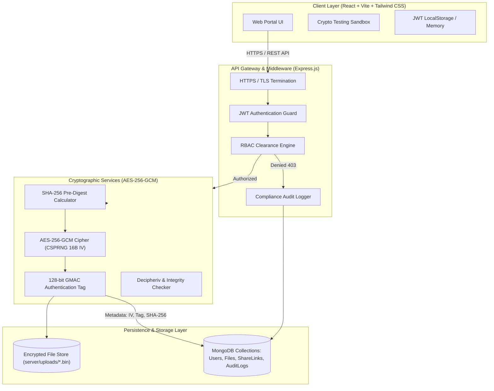

# Secure Data Exchange (SDE)
### *Centralized Institutional & Enterprise File-Sharing Platform*

[](https://nodejs.org/)
[](https://react.dev/)
[](https://expressjs.com/)
[](https://www.mongodb.com/)
[](https://csrc.nist.gov/)
[](https://csrc.nist.gov/)
[](LICENSE)

---

## 📌 Project Overview & Statement Alignment

**Secure Data Exchange** is a centralized, cryptographic file-sharing platform designed for enterprise and institutional environments (e.g., universities, healthcare consortia, financial departments, research laboratories). The platform addresses sensitive data exchange challenges by replacing unencrypted attachments and unmonitored links with an **authenticated encryption pipeline**, **granular Role-Based Access Control (RBAC)**, **end-to-end HTTPS/TLS transfers**, and **tamper-evident audit tracking**.

### Core Engineering Deliverables
1. **Centralized & Secure File-Sharing Repository:**
   - Multi-tenant departmental partitioning with institutional data classification (`PUBLIC`, `INTERNAL`, `CONFIDENTIAL`, `RESTRICTED`).
   - High-performance streaming and buffer uploads with zero plaintext leakage to disk.
   - Time-limited and password-protected external share tokens with single-use auto-burn caps.
2. **JWT Authentication & 3-Tier Granular RBAC:**
   - Stateless JSON Web Token authentication with bcrypt password hashing (10 salt rounds).
   - Strict role hierarchy: **Administrator** (`Admin`), **Institutional Officer / Faculty** (`Officer`), and **Standard User / Scholar** (`User`).
   - Automatic security violation interception and logging upon unauthorized policy attempts (`403 Forbidden`).
3. **Encrypted Pipeline & Metadata Tracking:**
   - **AES-256-GCM (Galois/Counter Mode):** Authenticated Encryption with Associated Data (AEAD) generating unique 16-byte CSPRNG Initialization Vectors (IV) and 128-bit Authentication Tags per file.
   - **Bit-Level SHA-256 Integrity Verification:** Pre-encryption digest calculation matched against post-decryption digest to detect transmission errors or bit-flipping attacks.
   - **MongoDB Metadata Engine:** Tracks cryptographic vectors, access frequency, upload latencies, departmental tags, and immutable audit logs.
   - **Native HTTPS / TLS Gateway:** Bundled self-signed SSL certificate generator enabling native TLS encrypted transfer over HTTPS.
   - **Dual-Mode Database Architecture:** Auto-detects external MongoDB URI; if not found, spins up an embedded in-memory MongoDB server for zero-configuration, instant execution during evaluations!

---

## 🏗️ System Architecture



---

## 🔐 Cryptographic Specifications

| Parameter | Specification | Purpose |
| :--- | :--- | :--- |
| **Cipher Algorithm** | `AES-256-GCM` | Authenticated symmetric encryption ensuring both confidentiality and authenticity. |
| **Key Size** | 256 bits (32 bytes) | Military-grade symmetric key security. |
| **Initialization Vector (IV)** | 128 bits (16 bytes) | Cryptographically secure pseudo-random number generator (`crypto.randomBytes`) unique for each file. |
| **Authentication Tag** | 128 bits (16 bytes) | Galois Message Authentication Code (GMAC) verification ensuring zero ciphertext tampering. |
| **Integrity Check** | `SHA-256` | Full plaintext checksum computed before encryption and matched after decryption. |
| **Transport Layer** | TLS 1.2 / TLS 1.3 | End-to-end transport encryption over HTTPS preventing MITM packet sniffing. |
| **Credential Hashing** | `bcrypt` (10 rounds) | Adaptive key-stretching hash algorithm protecting user passwords against rainbow tables. |

---

## 👥 Role-Based Access Control (RBAC) Matrix

| Resource / Action | Administrator (`Admin`) | Officer / Faculty (`Officer`) | Scholar / User (`User`) |
| :--- | :---: | :---: | :---: |
| **View All Repository Files** | ✅ Full Access | 🏢 Department Only | 👤 Own + Department Internal |
| **Access `PUBLIC` Files** | ✅ | ✅ | ✅ |
| **Access `INTERNAL` Files** | ✅ | ✅ (Departmental) | ✅ (Same Department Only) |
| **Access `CONFIDENTIAL` Files**| ✅ | ✅ | ❌ Blocked (`403 Forbidden`) |
| **Access `RESTRICTED` Files**  | ✅ Super-Access | ❌ (Unless Owner) | ❌ (Unless Owner) |
| **Upload Files & Classify**   | ✅ All Tiers | ✅ All Tiers | ✅ Up to `INTERNAL` |
| **Generate Share Links**       | ✅ All Files | ✅ Own & Dept Files | ✅ Own Files Only |
| **View Compliance Audit Logs**| ✅ Complete Ledger | 🏢 Dept Events Only | ❌ Forbidden |
| **Manage Users & Role Assignment** | ✅ Full Control | ❌ Forbidden | ❌ Forbidden |

---

## ⚡ Quick Start & Installation

### Prerequisites
- **Node.js** v18+ (tested on Node v24.12.0)
- **NPM** v9+
- *Optional:* Local MongoDB instance (The project automatically falls back to an embedded in-memory MongoDB if none is running!)

### 1. Clone the Repository
```bash
git clone https://github.com/your-username/secure-data-exchange.git
cd secure-data-exchange
```

### 2. Install Dependencies
Run the installation command in the root folder (or in server and client individually):
```bash
# Install root orchestration tools
npm install

# Install server dependencies
cd server && npm install && cd ..

# Install client dependencies
cd client && npm install && cd ..
```

### 3. Start Development Servers
From the root directory, launch both backend and frontend concurrently:
```bash
npm run dev
```

- **Client Application:** `http://localhost:3000` (or `http://localhost:5173`)
- **Backend API Gateway:** `http://localhost:5000`
- **Healthcheck:** `http://localhost:5000/api/health`

---

## 🧪 Pre-Seeded Institutional Demo Accounts

The project includes pre-seeded demo accounts with encrypted sample files and audit trails for immediate evaluation:

| Account Role | Email | Password | Assigned Department |
| :--- | :--- | :--- | :--- |
| **Chief Administrator** | `admin@institution.edu` | `Admin@12345` | Information Security |
| **Department Officer / Head** | `faculty@institution.edu` | `Officer@12345` | Computer Science |
| **Research Scholar / Student** | `student@institution.edu` | `Student@12345` | Computer Science |

> 💡 **Viva Tip:** The UI includes **1-Click Test Role Buttons** on the Login screen and in the top navigation bar, allowing you to seamlessly swap roles in real time during demonstrations!

---

## 🔬 Automated Testing Suite

The project includes comprehensive automated test coverage for cryptographic pipelines, tampering resistance, and RBAC rules:

```bash
npm test
```

### Test Cases Covered:
- `Crypto Pipeline: AES-256-GCM buffer encryption and decryption`
- `Crypto Pipeline: Tamper-resistance detection (1-bit corruption flips authentication tag rejection)`
- `Crypto Pipeline: SHA-256 integrity hash verification`
- `RBAC: Super-access for Administrator`
- `RBAC: Ownership access check`
- `RBAC: Departmental isolation for INTERNAL classification`
- `RBAC: Clearance restrictions for CONFIDENTIAL documents`
- `End-to-End Pipeline: In-Memory DB, Seeding, and Encrypted File Delivery`

---

## 📡 API Reference Overview

### Authentication (`/api/auth`)
- `POST /api/auth/register` - Enroll institutional profile.
- `POST /api/auth/login` - Authenticate credentials and return signed JWT.
- `GET /api/auth/me` - Retrieve authenticated user clearance.

### File Repository (`/api/files`)
- `POST /api/files/upload` - Encrypt file buffer via AES-256-GCM, calculate SHA-256, and store metadata in MongoDB.
- `GET /api/files` - List accessible files with RBAC filtering.
- `GET /api/files/:id/metadata` - Inspect cryptographic vectors (IV, AuthTag, SHA-256 digests).
- `GET /api/files/:id/download` - Decrypt ciphertext on the fly, verify SHA-256, and stream file.
- `DELETE /api/files/:id` - Eradicate encrypted ciphertext and database record.
- `GET /api/files/stats/summary` - Aggregate metrics (storage ratio, classification breakdown).

### Secure Sharing (`/api/share`)
- `POST /api/share/create` - Generate time-limited, password-protected token.
- `GET /api/share/:token/info` - Public query of file metadata without disclosure.
- `POST /api/share/:token/download` - Public decryption and transfer upon passkey verification.
- `DELETE /api/share/:token` - Immediate token revocation.

### Compliance & Administration
- `GET /api/audit` - Paginated immutable compliance audit trail (`Admin` / `Officer`).
- `GET /api/users` - Institutional user directory (`Admin` only).
- `PUT /api/users/:id/role` - Update clearance role and status (`Admin` only).

---

## 🎓 College Viva / Project Defense Questions

<details>
<summary><strong>1. Why did you choose AES-256-GCM over AES-256-CBC?</strong></summary>

**Answer:** AES-CBC requires a separate Message Authentication Code (e.g., HMAC-SHA256) to verify data integrity and is vulnerable to padding oracle attacks if not implemented flawlessly. AES-GCM is an **Authenticated Encryption with Associated Data (AEAD)** cipher that provides both confidentiality and data authenticity simultaneously using a Galois field multiplier (GMAC). Any bit-flip in ciphertext causes the authentication tag verification to fail immediately.
</details>

<details>
<summary><strong>2. How does the system prevent unauthorized access if someone gets the ciphertext files directly from the disk?</strong></summary>

**Answer:** Files saved on disk (`server/uploads/*.bin`) are pure ciphertext. Without the 256-bit master key and the unique 16-byte Initialization Vector (IV) stored in the database, the file cannot be decrypted. Furthermore, because each file uses a unique CSPRNG IV, two identical files produce entirely different ciphertexts.
</details>

<details>
<summary><strong>3. How does the Role-Based Access Control (RBAC) protect departmental isolation?</strong></summary>

**Answer:** Every file record in MongoDB has a `department` attribute and a `classification` attribute (`PUBLIC`, `INTERNAL`, `CONFIDENTIAL`, `RESTRICTED`). When a user issues a download or listing request, the `rbacMiddleware` evaluates the user's role and departmental membership. Even if a user crafts a direct API request with another department's file ID, the request is intercepted with a `403 Forbidden` and logged in the immutable audit ledger.
</details>

<details>
<summary><strong>4. How is End-to-End transfer security achieved?</strong></summary>

**Answer:** End-to-end security is achieved through a multi-tiered approach:
1. **In-Transit:** Transport Layer Security (TLS 1.3/HTTPS) encrypts the communication channel between browser and server.
2. **At-Rest:** Files are immediately encrypted using AES-256-GCM upon receipt in memory before touching disk storage.
3. **In-Application:** Plaintext SHA-256 checksums verify that decrypted data exactly matches the source byte-for-byte.
</details>

---

## 📄 License
This project is licensed under the MIT License - open for educational and institutional research purposes.
